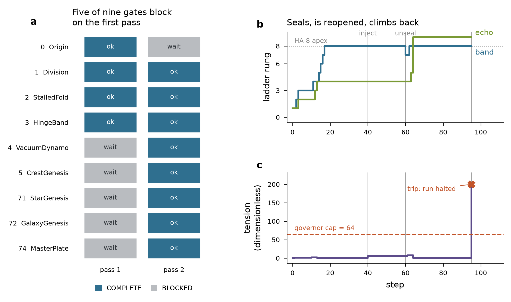

# Summary

Many computer models run as a sequence of stages, where each stage takes the
output of the one before it. When such a model reports "success," a user
usually cannot tell whether every stage actually did its work or whether some
stages silently skipped. `cold_fold_engine` is a small Python library that
makes each stage's outcome explicit and makes whole runs exactly repeatable.
Every stage, called a *plate*, states what it needs before it may run, what it
changes, and what must be true afterwards. Each plate then reports whether it
completed, was blocked waiting for earlier stages, or failed. A run produces a
cryptographic fingerprint of everything that happened, so anyone can confirm
that a second run is identical to the first. The library has no dependencies
beyond the Python standard library. It serves as the computational core of the
Cold Fold framework.

# Statement of need

Reproducibility is a basic requirement of computational research
[@sandve2013]. Many staged scripts nevertheless encode a stage's result as a
hard-coded success value. The prototype from which this package was rebuilt
had exactly that defect: every stage returned `COMPLETE` unconditionally, so a
passing run carried no information. `cold_fold_engine` addresses this with
three commitments:

1. **Outcomes that can fail.** A plate returns `COMPLETE` (postconditions
   hold), `BLOCKED` (preconditions unmet; state untouched), or `FAILED` (the
   plate produced illegal state; the run aborts). Separating expected waiting
   from defects makes partial progress visible. In the default scenario, five
   of nine plates legitimately block on the first pass.
2. **Determinism checked by machine.** Transitions contain no randomness,
   clock reads, or I/O. `Trace.digest()` computes SHA-256 over the canonical
   JSON of the full trace, so a test can assert a run's identity rather than
   rely on the author's claim.
3. **Computed, not declared, behaviour.** The default substrate has 127 nodes,
   the Mersenne prime $2^7 - 1$. Every attempt to split it evenly leaves a
   residue, which is banked as a dimensionless *tension* token. Stalls
   therefore follow from arithmetic that can be checked by hand. A governor
   halts the run when banked tension exceeds a fixed cap.

The target audience is researchers and developers who build staged or iterated
models and need auditable, replayable runs. The package makes no physical
claims: its state variables are dimensionless integer tokens without units.

# State of the field

General-purpose Python state-machine libraries such as `transitions`
[@transitions] and `python-statemachine` [@pystatemachine] model states and
event-triggered transitions, following the statechart tradition [@harel1987].
Workflow managers such as Snakemake [@molder2021] orchestrate file-based
pipelines and can rerun stages when their inputs change. None of these, by
default, combines (a) per-stage contracts in the design-by-contract sense
[@meyer1992], with a *blocked* outcome distinct from *failure*, (b) immutable
state threaded through pure transitions, and (c) a built-in digest of the
full execution trace. Adding these to an existing state-machine library would
mean replacing its mutable-model and callback design, which is the core of
what those libraries are. We therefore chose to build a small, dedicated
engine whose central contribution is this combination of guarantees, rather
than to contribute to an existing project.

# Software design

`EngineState` is a frozen dataclass. A plate cannot mutate shared state and
must return a new state through `evolve()`. This choice costs some allocation,
but it is what makes the trace digest meaningful and replay safe. The `Plate`
base class splits each stage into `check`, `apply`, and `verify`. The runner
calls `apply` only when `check` returns no reasons, and it marks the result
`FAILED` if `verify` reports any violation. Execution order follows data
dependency rather than plate number: plate 4 must run after plate 3 and before
plate 5, which `default_pipeline()` encodes explicitly. `Runtime` steps the
pipeline under a scripted list of `Perturbation`s. `CosmogenicEngine` acts as
orchestrator and governor and is the only component that can halt a run. Cycle
modules (`relativistic`, `collapse`, `demo`) are iterated maps with defined
fixed points, and they share a common `Cycle` base. Configuration constants
are pinned to the project's configuration files, and a test fails if they
drift. The suite contains 41 `pytest` tests, which cover plate contracts,
cycle behaviour, state validation, and digest stability.

# Research impact statement

[Replace with specific, verifiable evidence. JOSS asks for either *realized
impact* (publications, external users, integrations) or *credible near-term
significance* (benchmarks, reproducible materials, signs of community
readiness). Honest items available now: a public, tested, dependency-free
release; a Zenodo DOI ([DOI]); a published expected trace digest that anyone
can reproduce; CI on Linux and Windows across Python 3.9–3.13. Add any users,
talks, or downstream projects as they occur.]

# AI usage disclosure

[Required, and it must be complete and accurate. State the tools and versions
used (for example GitHub Copilot; Anthropic Claude, model claude-opus-5-5),
where they were used (engine code, tests, documentation, this paper), and the
nature of the assistance (for example, generating the rebuilt implementation
and tests from the author's prototype files and configuration). Confirm that
the author reviewed and validated the outputs and made the core design
decisions.]

# Acknowledgements

[Optional. List funding here, or write "This work received no external funding."]

# References
